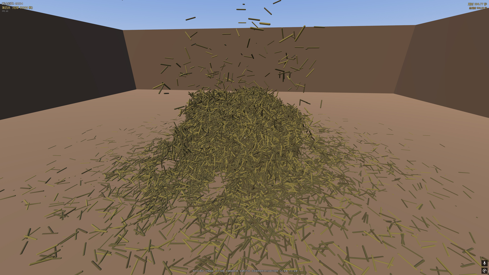

# 大海捞针 / Find the Needle
一款基于 Godot 4 打造的第一人称 3D 小游戏，在数万根物理模拟的稻草堆里找到那根针。

A first-person 3D game built with Godot 4 — locate the single needle hidden inside a fully physics-simulated haystack of ten thousands of straws.

## 玩法 / How to Play
找到隐藏在稻草堆中的银色针并左键点击即可获胜。
Locate the silver needle buried in the haystack and left click it to win.

左键点击稻草可将其移除；长按左键每秒 3 次连发。
Left-click a straw to remove it; hold for automatic removal at 3 shots per second.

右键发射空气炮，在命中点产生球形向外的力把稻草吹开；长按右键每秒 3 次连发。
Right-click fires an air cannon that pushes straws outward from the impact point on a spherical radius; 0.33-second cooldown per shot.

## 特性 / Features
Jolt Physics 3D 全物理模拟，稻草出生即冻结，被触碰时解冻，睡眠后转冻结，保持稳定帧率。
Full Jolt Physics 3D simulation. Straws spawn frozen, wake on touch, and re-freeze when settled to maintain stable framerate.

## 编译 / Build
Godot 4.7.1 或更新版本。
Godot 4.7.1 or newer.

## 许可 / License
MIT License
